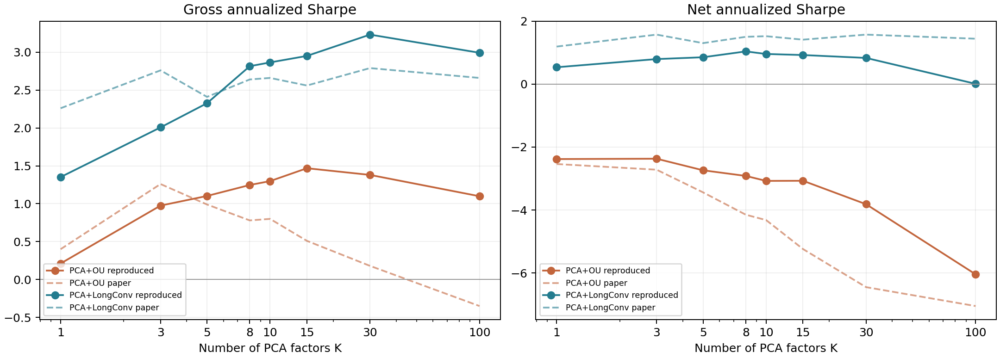
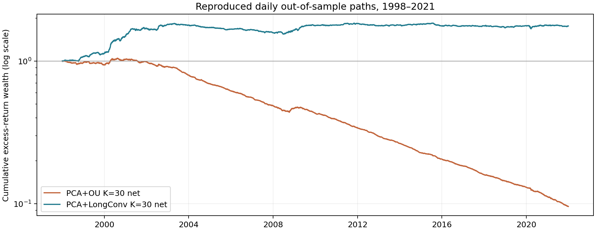

# PCA+OU 与 PCA+LongConv 复现报告

本次运行完整覆盖论文的 1998 年 1 月至 2021 年 12 月样本外区间，逐日更新 252 日 PCA，并分别运行 OU 阈值策略和每年重训的 LongConv。表中“本项目”是实际运行结果；“论文”是原文 Table 2 的比较数字。

## 样本与模型

- 样本外交易日：6,040；原始面板 1985–2021 年。月度股票池按前月末市值 top 500 形成。
- PCA 因子最大 K=100；逐日合格股票数均值 489.8，最低 441。
- 缺少当期收益、但仅凭过去信息仍合格的股票日：46。这些日期按零超额收益估值并单独记录缺失仓位；当日因子残差也受到该估值选择影响。
- 收益采用 RET_ADJ−rf，RET_ADJ 已包含退市回报；调仓成本为股票仓位差 L1 的 5bp，做空成本为做空绝对仓位的每日 1bp。
- LongConv 固定论文公布的 30 日回看、一层 32 维、30 epoch、Adam 学习率 0.003、dropout 0.1；1990–1995 年拟合、1996–1997 年验证，用于确定输入收益单位；1998–2021 年每年以前 8 年重训。
- 网络输入把小数残差乘 100，转为百分数单位；交易收益、成本和最终绩效仍用小数计。选择证据见 `results/input_scale_validation.csv`。

## 主要结果

年化收益率与波动率以百分数表示；Sharpe 为年化。年收益是 252×日均超额收益，不是复利 CAGR。

| 模型 | K | 本项目毛 Sharpe | 论文毛 Sharpe | 本项目净 Sharpe | 论文净 Sharpe | 本项目年化毛收益 | 本项目年化净收益 | 年换手成本 |
|---|---:|---:|---:|---:|---:|---:|---:|---:|
| PCA+OU | 1 | 0.21 | 0.40 | -2.38 | -2.54 | 1.11% | -12.49% | 12.35% |
| PCA+OU | 3 | 0.98 | 1.26 | -2.37 | -2.72 | 3.93% | -9.55% | 12.23% |
| PCA+OU | 5 | 1.10 | 0.99 | -2.74 | -3.44 | 3.85% | -9.56% | 12.16% |
| PCA+OU | 8 | 1.25 | 0.78 | -2.92 | -4.15 | 4.01% | -9.38% | 12.13% |
| PCA+OU | 10 | 1.30 | 0.80 | -3.08 | -4.32 | 3.97% | -9.40% | 12.12% |
| PCA+OU | 15 | 1.47 | 0.51 | -3.07 | -5.24 | 4.32% | -9.03% | 12.10% |
| PCA+OU | 30 | 1.38 | 0.18 | -3.82 | -6.45 | 3.53% | -9.76% | 12.04% |
| PCA+OU | 100 | 1.10 | -0.35 | -6.04 | -7.05 | 2.05% | -11.28% | 12.07% |
| PCA+LongConv | 1 | 1.35 | 2.26 | 0.53 | 1.19 | 10.33% | 4.07% | 5.38% |
| PCA+LongConv | 3 | 2.01 | 2.76 | 0.79 | 1.57 | 10.64% | 4.19% | 5.45% |
| PCA+LongConv | 5 | 2.33 | 2.41 | 0.85 | 1.30 | 10.25% | 3.73% | 5.49% |
| PCA+LongConv | 8 | 2.81 | 2.64 | 1.04 | 1.50 | 10.90% | 3.98% | 5.84% |
| PCA+LongConv | 10 | 2.86 | 2.66 | 0.96 | 1.52 | 10.55% | 3.49% | 5.97% |
| PCA+LongConv | 15 | 2.95 | 2.56 | 0.92 | 1.41 | 10.17% | 3.14% | 5.90% |
| PCA+LongConv | 30 | 3.23 | 2.79 | 0.83 | 1.57 | 9.50% | 2.41% | 5.97% |
| PCA+LongConv | 100 | 2.99 | 2.66 | 0.01 | 1.44 | 6.38% | 0.02% | 5.21% |

K=30 时，本项目 LongConv 净 Sharpe 为 0.83，低于论文的 1.57；年化毛收益 9.50% 和波动率 2.94% 也低于论文的 15.15% 与 5.42%。因此差异不只来自交易费用，因子残差和策略风险敞口亦有差别。
OU 的本项目 K=30 净 Sharpe 为 -3.82，论文为 −6.45；两者都显示毛收益经高换手后转负，本项目年化换手成本为 12.04%。

## 样本外前的输入单位验证（K=30）

两种输入单位均只用 1990–1995 年拟合，并在 1996–1997 年验证；事前选取净 Sharpe 较高的单位用于全部样本外年份。

| 输入单位 | 验证期毛 Sharpe | 验证期净 Sharpe |
|---|---:|---:|
| 小数残差 × 1 | -1.17 | -2.27 |
| 小数残差 × 100 | 9.04 | 4.62 |

## K=30 的交易成本分解

| 模型 | 年化毛收益 | 年换手成本 | 年做空成本 | 年化净收益 | 每日 L1 换手 | 缺失收益仓位日期 |
|---|---:|---:|---:|---:|---:|---:|
| PCA+OU | 3.53% | 12.04% | 1.26% | -9.76% | 0.955 | 34 |
| PCA+LongConv | 9.50% | 5.97% | 1.12% | 2.41% | 0.474 | 34 |

## 与原文数字不同的原因及解释边界

论文主文没有公布两个 PCA 基准的完整代码。本文选用严格滞后的协方差 PCA 和正交投影；原文对协方差与相关性 PCA 的措辞不一致，其参考文献 [19] 的公开实现采用相关矩阵 PCA 和 60 日 OLS beta。两者的残差、交易仓位和成本会不同。
LongConv 的输入投影、激活与输出映射未在论文公开，本文用共享标量输入层、因果 LongConv、GELU、dropout 和标量输出层；优化批次与随机种子也是本项目设定。模型完整定义见 `models.py` 和 `run_manifest.json`。
本项目数据虽然覆盖相同年月与 top500 规则，但无法证明与作者原始 CRSP/Compustat 文件逐行一致。提供数据中存在少数缺失实现收益，且退市后旧月度名单可能仍保留股票；本文在已知退市事件下一交易日移出，并披露剩余缺失估值。
原始三份 parquet 最初位于微信临时目录，在完整数据审计与逐日 PCA 缓存生成后，该临时目录于 2026-11-06 被清理。本次结果使用已完成并以 SHA-256 封存的缓存继续计算；本地 `cache/seal.json` 记录缓存哈希及审计时的原始文件哈希；大型缓存未上传 GitHub。如需从原始 parquet 重新计算 PCA，必须重新取得这些文件。
市场 beta 采用本面板可观测股票的前日市值加权代理，不能与论文的市场因子 beta 作逐数字比较。
因此本次成果是可审计的**方法复现与样本外运行**。任何差异应首先检查 PCA/beta 约定、网络外围、数据版本和缺失值处理；不应根据 1998–2021 年样本外表现反向调参。

## 复核与文件

`results/metrics.csv` 是本表的数值来源。仓库中的 `daily.csv` 提供逐日收益与成本；完整逐股 `weights.npz` 留在本地工作目录，核验记录保存在 `results/verification.json`；`yearly.csv` 便于查看时间稳定性。`audit.json` 记录原始文件 SHA-256 与数据质量审计，`run_manifest.json` 记录配置、库版本和 PCA 缓存指纹。`results/verification.json` 记录从逐股仓位重新计算损益的核对。运行方法与工程选择见 `README.md`，论文与演示核对见 `notes/`。

论文：[Epstein et al. (2025)](https://arxiv.org/abs/2510.11616)；OU 规则的原始参考：[Guijarro-Ordonez et al. (2021)](https://arxiv.org/abs/2106.04028)。
